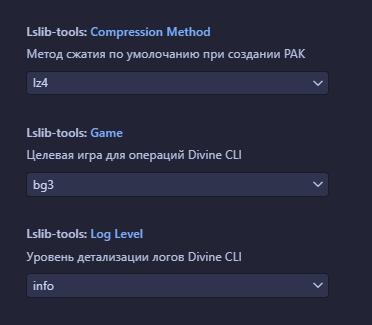
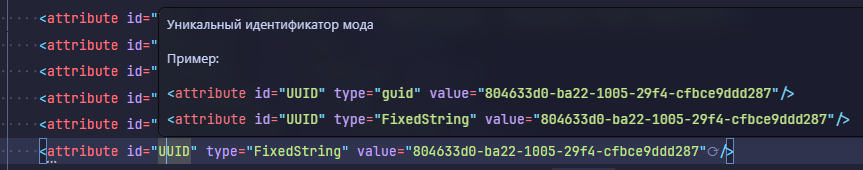
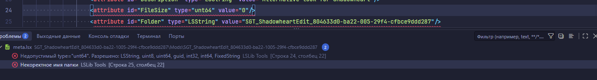
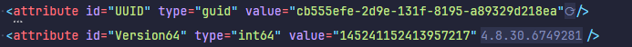
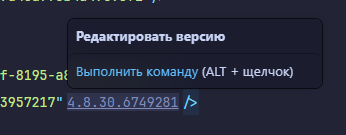
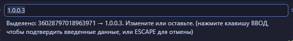
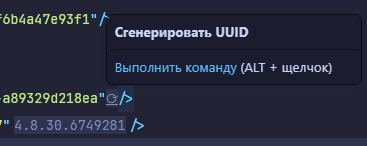
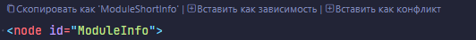
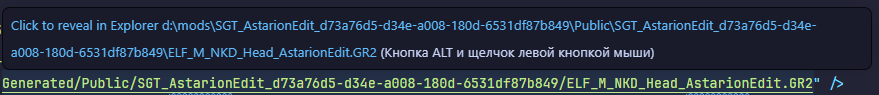
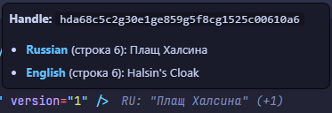

# 🛠️ LSLib VS Code Tools

**Набор инструментов для моддинга Baldur's Gate 3 и Divinity: Original Sin 2 прямо в VS Code**

---

## 📖 О расширении

**LSLib VS Code Tools** — это расширение для Visual Studio Code, которое интегрирует инструменты [LSLib](https://github.com/Norbyte/LSLib) прямо в ваш редактор. Распаковывайте моды, конвертируйте ресурсы и редактируйте файлы прямо в привычной среде разработки.

---

### ⚙️ Divine CLI

#### 📦 Работа с `.pak` файлами

- **Пакетная распаковка `.pak`** — извлечение `.pak` архивов в папку с тем же именем.
- **Пакетная запаковка `.pak`** — создание `.pak` архивов из папки одним кликом.

#### 🔄 Конвертация ресурсов

- **Пакетная конвертация ресурсов**:
  - `LSF ↔ LSX` (бинарный формат ↔ XML)
  - `LSF ↔ LSJ` (бинарный формат ↔ JSON)
  - `LSB ↔ LSX/LSJ` (скриптовые бинарные форматы)
  - `loca ↔ LSX` (файлы локализации)

#### 🎛️ Конфигурация CLI

Вы можете настроить `game`, `compressionMethod` и `logLevel` для `divine CLI` прямо в настройках расширения.

### 📄 Поддержка `meta.lsx`

- **Надёжный парсер на базе `sax`**.
- **HoverProvider** — подсказки по атрибутам, типам и нодам.

- **DiagnosticProvider** — полноценная диагностика файлов (ошибки XML, неверные атрибуты, невалидные версии и т.д.).

- **InlayHints** — визуальное декодирование и быстрое редактирование `Version64`, а также генерация нового `UUID` в один клик.
  - **Декодирование и подсказки:**
    
  - **Быстрое редактирование версии:**
    
  - **Диалог выбора версии:**
    
  - **Генерация нового UUID:**
    

 

- **CodeLens** — быстрые действия для копирования и вставки `ModuleShortDesc`.

### 🔗 Навигация по файлам (Document Link Provider)

- Пути к ресурсам в атрибутах `source` и `value` теперь кликабельны. Вы можете переходить прямо к `.GR2`, `.DDS` и другим файлам в вашем моде.

### 🌍 Работа с локализацией

- **Умные декорации**: просмотр переводов для `handle` прямо в редакторе.
- **Быстрый переход**: клик по ссылке открывает файл локализации на нужной строке.

### 🙏 Благодарности

- **Norbyte** — за создание LSLib.
- **Larian Studios** — за прекрасные игры!
